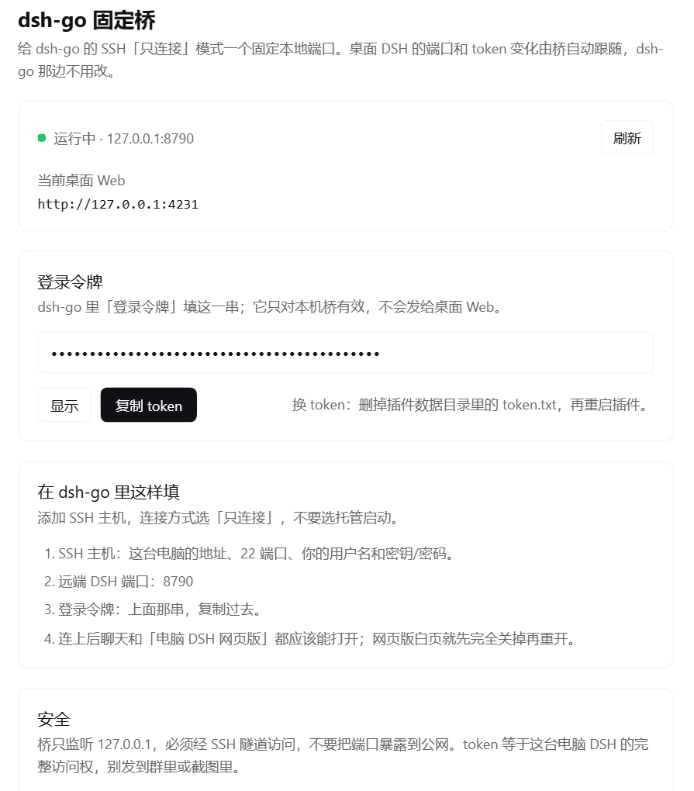

# dsh-go-bridge

[中文](README.md) · **English**

A small DSH plugin that gives **dsh-go** a stable SSH attach point to the **already-running DSH desktop app**, instead of starting a second "dsh web" instance.

The desktop app's Web port and login token can change every time it starts. This plugin listens on a fixed loopback port ("127.0.0.1:8790" by default), authenticates dsh-go with its own long-lived token, and proxies requests to the current desktop Web:

```text
dsh-go ──SSH tunnel──▶ 127.0.0.1:8790 ──bridge──▶ current DSH desktop Web
```

It handles HTTP, the "/api/remote.mux" WebSocket, and the desktop Web's "Host" / "Origin" / "Referer" checks.



## Requirements

- A running DSH desktop app with its Web UI
- OpenSSH Server (or any SSH server dsh-go can reach)
- dsh-go with its SSH host feature
- The plugin itself does not handle networking or depend on a particular mesh/VPN; dsh-go just needs to reach this computer over SSH (LAN, public SSH, Tailscale, etc.)

## Install

Install the directory with DSH, for example:

```text
plugin_manager install_bundle target: D:\path\to\dsh-go-bridge
```

The bridge listens on "127.0.0.1:8790" after the plugin starts. If it does not start, disable and re-enable the plugin, or restart DSH.

**Restart DSH once after installing** so the settings page is discovered. It will then appear under Settings as **dsh-go 桥** (the UI labels are currently in Chinese), showing status, port, and the login token.

Change the port in "cordis.patch.yml" if needed:

```yaml
- insert:
    - id: dsh-go-bridge
      name: 'dsh-go-bridge'
      config:
        port: 8790
```

## Get the token

Use the settings page: **Settings → dsh-go 桥 → 登录令牌**. The token can be revealed and copied there.

Or read it from:

```text
~/.dsh/plugins-data/dsh-go-bridge/token.txt
```

On Windows:

```text
C:\Users\<you>\.dsh\plugins-data\dsh-go-bridge\token.txt
```

There is also a loopback-only info endpoint on the DSH desktop Web: "/dsh-go-bridge". It returns "port", "token", and the current upstream URL.

## Configure dsh-go

Add an SSH host and fill in:

- **SSH host**: this computer's address, port 22, your username and key/password
- **Connection mode**: **Attach only** (do not use managed start)
- **Remote DSH port**: "8790" (or your configured port)
- **Login token**: the bridge token from above

No start command is needed. Do not let dsh-go start "dsh web" for this host.

## How it works

1. Validates the bridge token from dsh-go and exchanges it for a "dsh-auth-go-bridge" cookie.
2. Uses the current desktop Web "connection.authenticatedUrl" to get a fresh desktop "dsh-auth-*" cookie.
3. Proxies HTTP requests and the "/api/remote.mux" WebSocket to the desktop Web.
4. Rewrites "Host", "Origin", and "Referer" to the desktop Web's address.
5. Refreshes the desktop cookie and retries once on upstream 401/403.

When the desktop DSH restarts, the plugin restarts with it, picks up the new desktop port/token, and keeps the same bridge token. dsh-go does not need to be reconfigured.

## Security

- The bridge only listens on "127.0.0.1" and must be reached through an SSH tunnel. Do not expose port 8790 to the public internet.
- The bridge token grants full access to this DSH instance. Do not post it in chat or screenshots.
- To rotate the token, delete "~/.dsh/plugins-data/dsh-go-bridge/token.txt", then disable/enable the plugin (or restart DSH), and update dsh-go.
- The "/dsh-go-bridge" info route only allows loopback requests.
- Prefer SSH key authentication and restrict which users may log in.

## Troubleshooting

**Connected, but the "desktop DSH web UI" shows no sessions / blank page**

Close the web UI page inside dsh-go completely and reopen it (backgrounding is not enough). The bridge rewrites "Host", "Origin", and "Referer"; an old page may still hold a previous 403.

**401 / bad token**

The token was copied incorrectly or has been rotated. Read the current token from the settings page or "token.txt", then update dsh-go.

**EADDRINUSE / port already in use**

Another process or bridge is using 8790. Change "port" in "cordis.patch.yml" and change the "remote DSH port" in dsh-go to match.

**SSH cannot connect**

Check that OpenSSH is running, port 22 is allowed through the firewall, and a plain "ssh" from the phone's network works. SSH connectivity is outside this plugin.

**Desktop port changed but the bridge still uses the old one**

A full DSH restart also restarts the plugin, so the bridge re-reads the port. If only the desktop Web restarted, disable and re-enable the plugin.

## Compatibility

Tested with the DSH desktop app (November 2026) and dsh-go's SSH attach-only mode. dsh-go is a third-party client and this is not an official component. Protocol changes in DSH or dsh-go may require updates.

## Development

- "index.js": plugin entry; registers the loopback info route and starts the bridge.
- "lib/bridge.js": stable token, login cookie, HTTP/WebSocket proxy, header rewriting.
- "client.js": Settings page bundle.
- No build step and no runtime dependencies.

## License

MIT
