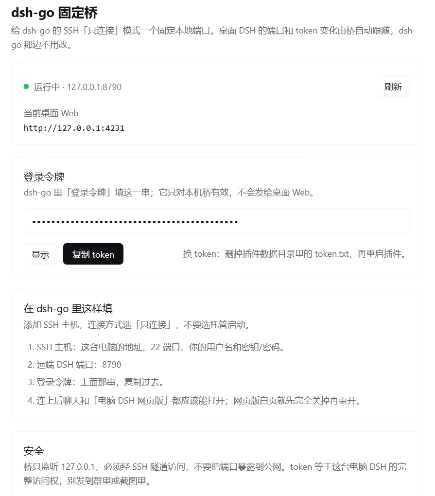

# dsh-go-bridge

**中文** · [English](README.en.md)

让 **dsh-go** 的 SSH「只连接」模式连上**正在运行的 DSH 桌面版**，而不是另外启动一个 `dsh web` 实例。



DSH 桌面版的 Web 端口和登录 token 每次启动都可能变化，dsh-go 很难一直跟着改。这个插件在本机开一个固定端口（默认 `127.0.0.1:8790`），用自己的稳定 token 认证 dsh-go，再代理到当前桌面 Web：

```text
dsh-go ──SSH tunnel──▶ 127.0.0.1:8790 ──bridge──▶ 当前 DSH 桌面 Web
```

它会处理 HTTP、`/api/remote.mux` WebSocket，以及桌面 Web 的 Host / Origin / Referer 校验。

## 要求

- 运行中的 DSH 桌面版（带 Web UI）
- OpenSSH Server（或 dsh-go 能连上的 SSH 服务）
- dsh-go 的 SSH 主机功能
- 插件本身不处理网络连通性，也不依赖特定组网方式；只要 dsh-go 能通过 SSH 到达这台电脑即可（局域网、公网 SSH、Tailscale 等都可以）

## 安装

把本目录交给 DSH 安装，例如：

```text
plugin_manager install_bundle target: D:\path\to\dsh-go-bridge
```

安装后插件会自动监听 `127.0.0.1:8790`。如果没起来，在插件管理里禁用再启用一次，或重启 DSH。

安装后**重启一次 DSH**，设置里会出现「dsh-go 桥」页面，可以直接看运行状态、端口、登录令牌，并复制 token，不需要手动翻数据目录。

端口可以在 `cordis.patch.yml` 里改：

```yaml
- insert:
    - id: dsh-go-bridge
      name: 'dsh-go-bridge'
      config:
        port: 8790
```

## 拿 token

桥的 token 在：

```text
~/.dsh/plugins-data/dsh-go-bridge/token.txt
```

Windows 一般是：

```text
C:\Users\<你>\.dsh\plugins-data\dsh-go-bridge\token.txt
```

也可以在本机浏览器打开 DSH 桌面 Web 的 `/dsh-go-bridge`（只允许 loopback 访问），返回 JSON 里有 `port`、`token` 和 `upstream`。

## 在 dsh-go 里连接

添加 SSH 主机，填：

- SSH 主机：这台电脑的地址，端口 22，用户名和密钥/密码按你的 OpenSSH 配置
- 连接方式：**只连接**（attach-only）
- 远端 DSH 端口：`8790`（或你改过的端口）
- 登录令牌：上面拿到的 bridge token

不需要填启动命令，也不需要让 dsh-go 启动 `dsh web`。

## 它做了什么

1. 校验 dsh-go 带来的 bridge token，换成 `dsh-auth-go-bridge` cookie。
2. 用当前桌面 Web 的 `connection.authenticatedUrl` 登录取 `dsh-auth-*` cookie。
3. 把 HTTP 请求和 `/api/remote.mux` WebSocket 转发到桌面 Web。
4. 重写 `Host`、`Origin`、`Referer` 为桌面 Web 的地址，避免桌面端的 browser-trust / Host fence 拒绝。
5. 上游 401/403 时刷新桌面 cookie 重试一次。

桌面 DSH 重启时插件会跟着重启，自动读取新的桌面端口和 token；桥自己的 token 不变，dsh-go 那边不用改。

## 安全

- 桥只监听 `127.0.0.1`，必须经 SSH 隧道访问；不要把 8790 暴露到公网。
- bridge token 等于这台电脑 DSH 的完整访问权，别发到群里或截图里。
- 要换 token：删除 `~/.dsh/plugins-data/dsh-go-bridge/token.txt`，禁用/启用插件（或重启 DSH），然后在 dsh-go 里更新。
- `/dsh-go-bridge` 信息路由只允许 loopback 请求。
- 建议 SSH 使用密钥登录，并限制允许登录的用户。

## 排错

**连上但网页版读不到会话 / 白页**

把 dsh-go 里的网页版页面完全关掉再重开（只切后台不够）。这个插件已经同时重写 `Host`、`Origin` 和 `Referer`；如果仍是旧页面，它可能还挂着上一次的 403。

**401 / bad token**

token 复制错了，或换过 token。重新读 `token.txt`，在 dsh-go 里更新。

**EADDRINUSE / 端口被占用**

8790 已被别的程序或另一个桥占用。改 `cordis.patch.yml` 的 `port`，同时改 dsh-go 的“远端 DSH 端口”。

**SSH 连不上**

先在本机确认 OpenSSH 服务在跑、防火墙放行 22；再用普通 `ssh` 从手机网络试一次。和这个插件无关的 SSH 问题需要先解决。

**桌面端口变了但桥还连着旧端口**

DSH 整体重启时插件会一起重启，桥会重新读端口；如果只重启了桌面 Web、没重启插件，禁用/启用一次插件。

## 兼容性

在 DSH 桌面版 2026-11 和 dsh-go 的 SSH attach-only 模式下实测通过。dsh-go 是第三方客户端，本插件不是官方组件；DSH / dsh-go 升级后协议若变化，可能需要跟着改。

## 开发

- `index.js`：插件入口，注册 `/dsh-go-bridge` 信息路由并启动桥。
- `lib/bridge.js`：稳定 token、登录 cookie、HTTP/WebSocket 代理和请求头重写。
- 没有构建步骤，没有运行时依赖。

## License

MIT
